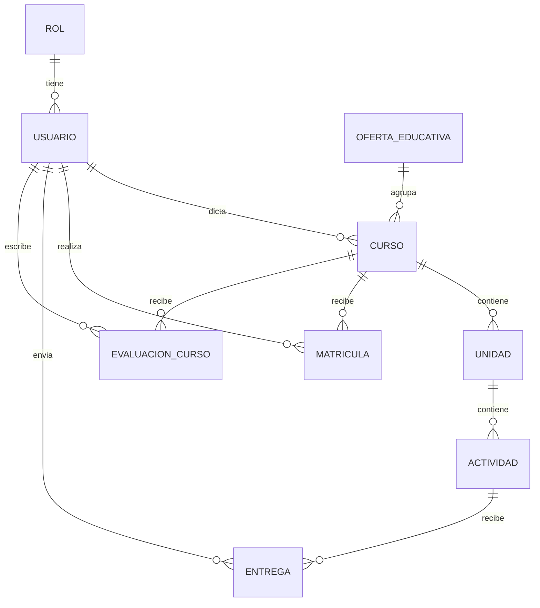

# Arquitectura y decisiones de diseno

## 1. Resumen

Backend REST en capas para la plataforma de cursos virtuales. La app Android (frontend) consume estos servicios.

```
Cliente (Postman / app Android)
        |  HTTP + JSON
        v
Controlador   (recibe la peticion, valida el JSON, devuelve el codigo HTTP)
        v
Servicio      (reglas de negocio, transacciones)
        v
Repositorio   (Spring Data JPA)
        v
Base de datos (H2 en archivo)
```

Paquetes (`co.edu.unipiloto.plataforma`):

| Paquete | Contenido |
| --- | --- |
| `controlador` | Endpoints REST. Sin logica de negocio |
| `servicio` | Reglas de negocio, calculo de progreso y estadisticas |
| `repositorio` | Interfaces de acceso a datos |
| `modelo` | Entidades JPA y enumerados |
| `dto` | Objetos de peticion y respuesta (con validaciones) |
| `excepcion` | Excepciones del negocio y manejador global de errores |
| `config` | Cifrado de contrasenas, datos iniciales, documentacion OpenAPI |

## 2. Decisiones

| Decision | Alternativa | Motivo |
| --- | --- | --- |
| Spring Boot 2.7.18 sobre Java 8 | JAX-RS/GlassFish (como el laboratorio) | El JDK disponible es Java 8; la 2.7 es la ultima linea de Spring Boot compatible. Arranca con un solo comando, sin servidor de aplicaciones |
| Arquitectura en capas | Todo en el controlador | Cada capa tiene una responsabilidad; facilita cambios y pruebas |
| DTO de peticion y respuesta | Exponer las entidades | La API no filtra datos internos (contrasena cifrada, clave de matricula) y se puede evolucionar sin romper la base de datos |
| H2 en archivo | MySQL / PostgreSQL | Cero instalacion para la demo y para los companeros. Cambiar de motor solo requiere modificar `application.properties` y la dependencia |
| JPA con consultas derivadas | SQL manual | Menos codigo, independiente del motor |
| BCrypt para contrasenas | Texto plano | Nunca se guardan contrasenas legibles |
| Manejador global de errores | try/catch en cada metodo | Todas las respuestas de error tienen el mismo formato JSON |
| Borrado en cascada explicito (`Limpieza`) | `CascadeType.REMOVE` | El orden de borrado queda visible y facil de explicar |
| Enumerados guardados como texto | Numeros | La base de datos es legible (`TALLER`, no `0`) |

## 3. Atributos de calidad

| Atributo | Como se logra |
| --- | --- |
| Mantenibilidad | Capas separadas, nombres en espanol del dominio, una clase por responsabilidad |
| Seguridad | Contrasenas con BCrypt; respuestas sin datos sensibles; validacion de entrada; permisos por rol en las reglas (solo el docente del curso califica, solo estudiantes se matriculan) |
| Integridad de datos | Restricciones unicas (una matricula, entrega y evaluacion por estudiante), transacciones, borrado en cascada controlado |
| Usabilidad de la API | Codigos HTTP correctos (201, 204, 400, 401, 403, 404, 409), mensajes en espanol, Swagger UI |
| Portabilidad | Java 8, base de datos embebida, sin servidor externo |
| Testabilidad | El calculo de progreso es una funcion estatica sin base de datos (`ProgresoServicio.construir`); coleccion Postman con pruebas automaticas |
| Escalabilidad | Servicio sin estado de sesion; el motor de base de datos se puede reemplazar por uno de produccion |

Limitacion conocida: el login valida las credenciales pero todavia no emite un token; los endpoints no exigen autenticacion. La Parte 2 puede agregar JWT con Spring Security. Los permisos por rol ya se verifican dentro de las reglas de negocio donde el rol importa.

## 4. Modelo de datos



Restricciones unicas: `(estudiante, curso)` en matriculas, `(actividad, estudiante)` en entregas, `(curso, estudiante)` en evaluaciones de curso.

## 5. Reglas de negocio principales

- Los pesos de los tres cortes de un curso deben sumar 100.
- Solo un usuario con rol DOCENTE activo puede dictar un curso.
- Una oferta CERRADA no admite cursos ni matriculas nuevas; las matriculas respetan los cupos de la oferta.
- Si el curso tiene clave de matricula, debe enviarse correcta.
- Solo se entrega dentro de la ventana `fechaInicio` - `fechaLimite`, estando matriculado, una sola vez por actividad.
- El tipo de entrega manda: ARCHIVO exige `nombreArchivo`; TEXTO y PREGUNTAS exigen `textoRespuesta`.
- Solo el docente del curso califica (nota 0.0 a 5.0) y retroalimenta.
- Una entrega calificada no se modifica ni se elimina.
- En un mismo corte, los porcentajes de las actividades no pueden superar 100.

## 6. Calculo de progreso (igual que la app Android)

- `PONDERADO` cuando los pesos de corte suman 100: nota del corte = suma(nota x porcentaje / 100); nota acumulada = suma(nota del corte x peso del corte / 100).
- `PROMEDIO_SIMPLE` cuando no suman 100: promedio de todas las actividades.
- Una actividad sin calificar cuenta 0 en la nota acumulada.
- La nota final solo existe cuando todas las actividades estan calificadas. Aprueba con 3.0 o mas.
- Porcentaje de avance = actividades entregadas / total x 100.

## 7. Endpoints

Formato de fechas: `2026-12-31T23:59:00`. Enumerados en MAYUSCULAS.

| Recurso | Metodo y ruta | Descripcion |
| --- | --- | --- |
| Auth | `POST /api/auth/login` | Inicio de sesion |
| Roles | `GET /api/roles`, `GET /api/roles/{id}` | Consultar |
| | `POST /api/roles`, `PUT /api/roles/{id}`, `DELETE /api/roles/{id}` | Crear, actualizar, eliminar |
| Usuarios | `GET /api/usuarios?rolId=`, `GET /api/usuarios/{id}` | Consultar |
| | `POST`, `PUT /{id}`, `DELETE /{id}` en `/api/usuarios` | Crear, actualizar, eliminar |
| Ofertas | `GET /api/ofertas?estado=`, `GET /api/ofertas/{id}` | Consultar |
| | `POST`, `PUT /{id}`, `DELETE /{id}` en `/api/ofertas` | Crear, actualizar, eliminar |
| Cursos | `GET /api/cursos?docenteId=&ofertaId=`, `GET /api/cursos/{id}` | Consultar |
| | `POST`, `PUT /{id}`, `DELETE /{id}` en `/api/cursos` | Crear, actualizar, eliminar |
| | `POST /api/cursos/{id}/duplicar?semestre=&fechaFinalizacion=` | Copiar curso con unidades y actividades |
| Unidades | `GET /api/unidades?cursoId=`, `GET /api/unidades/{id}` | Consultar |
| | `POST`, `PUT /{id}`, `DELETE /{id}` en `/api/unidades` | Crear, actualizar, eliminar |
| Actividades | `GET /api/actividades?unidadId=&cursoId=`, `GET /api/actividades/{id}` | Consultar |
| | `POST`, `PUT /{id}`, `DELETE /{id}` en `/api/actividades` | Crear, actualizar, eliminar |
| Matriculas | `GET /api/matriculas?estudianteId=&cursoId=`, `GET /api/matriculas/{id}` | Consultar |
| | `POST /api/matriculas`, `DELETE /api/matriculas/{id}` | Matricular, cancelar |
| Entregas | `GET /api/entregas?actividadId=&estudianteId=&cursoId=`, `GET /api/entregas/{id}` | Consultar |
| | `POST /api/entregas`, `PUT /api/entregas/{id}`, `DELETE /api/entregas/{id}` | Entregar, modificar, eliminar |
| | `PUT /api/entregas/{id}/calificacion` | Calificar y retroalimentar |
| Evaluacion de curso | `GET /api/evaluaciones-curso?cursoId=`, `GET /{id}` | Consultar |
| | `POST`, `PUT /{id}`, `DELETE /{id}` en `/api/evaluaciones-curso` | Crear, actualizar, eliminar |
| Seguimiento | `GET /api/seguimiento/cursos/{cursoId}/estudiantes/{estudianteId}` | Progreso de un estudiante |
| | `GET /api/seguimiento/cursos/{cursoId}` | Progreso de todos los matriculados |
| Estadisticas | `GET /api/estadisticas/cursos/{cursoId}` | Estadisticas de un curso |
| | `GET /api/estadisticas/general` | Estadisticas de la plataforma |

Formato de error (todos los casos):

```json
{
  "timestamp": "2026-11-22T17:30:00",
  "status": 409,
  "error": "Conflict",
  "mensaje": "El estudiante ya esta matriculado en este curso",
  "ruta": "/api/matriculas",
  "detalles": null
}
```

## 8. Guion sugerido para la sustentacion (10 minutos)

1. Explicar el problema y la arquitectura en capas (diagrama de la seccion 1) y por que Spring Boot 2.7 con Java 8.
2. Mostrar el servidor arrancando y Swagger UI.
3. Ejecutar en Postman las carpetas 01 a 06 (CRUD) y senalar un caso de error de validacion (400) y uno de conflicto (409).
4. Ejecutar la 07 y 08: matricula, entrega, intento de calificar como estudiante (403), calificacion del docente con retroalimentacion.
5. Ejecutar la 09 y 10: progreso parcial (EN_CURSO) y luego nota final 3.35 APROBADO, explicando la formula.
6. Ejecutar la 11 y 12: evaluacion del curso y estadisticas.
7. Mostrar la consola H2 con las tablas y la contrasena cifrada.
8. Cerrar con los atributos de calidad y la limitacion conocida (token JWT para la Parte 2).
